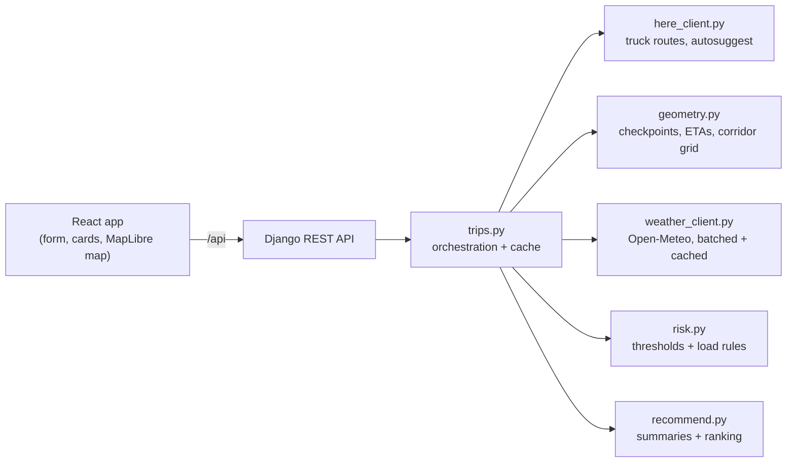

# Truck Weather Routing

A React + Django web app that helps a truck driver pick the safest route. It compares up to three truck routes using the forecast weather each stretch of road will have **when the truck gets there**, applies the load-dependent risk rules, and recommends a route. A heatmap shows the forecast along the trip corridor for the next 48 hours.

- **Live app:** https://truck-weather-routing-32v6.onrender.com
- **Walkthrough video (Loom):** https://www.loom.com/share/9fbe6c77099d45679e174d89cdf50fae

---

## What it does

1. **Input:** origin and destination (US address autosuggest), departure date/time (now up to 7 days ahead), load weight, and a checkpoint interval of 10, 25 or 50 miles.
2. **Routes:** HERE Routing v8 in truck mode returns up to three routes for the truck's gross weight.
3. **Checkpoints:** each route gets a checkpoint every N miles, plus one at the destination. Each checkpoint's ETA comes from HERE's per-segment travel times, so highway and city stretches are timed realistically instead of using an average speed.
4. **Weather:** an hourly forecast (Open-Meteo) is looked up for every checkpoint at its ETA.
5. **Risk:** wind, rain and snow are classified with the assessment's thresholds and load rules. The worst condition sets the checkpoint's level.
6. **Recommendation:** routes are ranked by No Travel miles, then Severe miles, High miles, average risk and travel time. The recommended route shows the reason it won.
7. **Map:** the selected route is drawn in risk colours per checkpoint segment, and the alternatives are grey and clickable. Clicking a checkpoint opens its ETA, weather, the condition that set the risk, and any load rule applied.
8. **Heatmap:** a 0–48 h slider, starting at departure, shades the corridor around the routes. Layers: overall **Risk** (load rules included), or the actual **Wind / Rain / Snow** values with the risk thresholds marked. Play animates the hours, a truck marker shows where the truck is at the selected hour, and playback stops when it arrives.

---

## Risk rules and how ambiguities were resolved

The assessment's tables are implemented in [`backend/routing/risk.py`](backend/routing/risk.py) and the ranking in [`backend/routing/recommend.py`](backend/routing/recommend.py). Both are pure functions with boundary-by-boundary unit tests. The table below lists the places where the spec left room for interpretation and what this app does.

| Topic | Decision | Why |
|---|---|---|
| Range boundaries | Lower bound inclusive: 25 mph is Moderate, 0.25 in/hr rain is High. Rain/snow No Travel is strictly `> 1.00` / `> 3.0`, so exactly 1.00 / 3.0 is Severe. Wind No Travel is `≥ 55`. | The table's ranges overlap at their edges (e.g. "0.10–0.25" and "0.25–0.50"). This reading follows the explicit `<`, `>` and `≥` signs in the spec. |
| Checkpoint level | Worst of wind, rain and snow. The UI shows which condition set it. | A checkpoint is only as safe as its worst hazard. |
| Load rules | Applied to wind only, and they can only raise a level. `> 30,000 lb` and `> 40,000 lb` are strict. | Matches the spec's wording. |
| Wind measure | Sustained 10 m wind speed. Gusts are shown but not scored. | The thresholds match sustained-wind scales; scoring gusts would flag almost any breezy day. |
| Rain | Open-Meteo `rain + showers`. | `rain` alone excludes convective downpours, which are the most dangerous. |
| Matching an ETA to hourly data | Precipitation uses the hour bucket that contains the ETA (14:40 → the 14:00–15:00 total). Wind and temperature use the nearest hour. | Open-Meteo precipitation is the total for the preceding hour; wind is instantaneous. |
| "Severe miles" | Each checkpoint represents the road halfway to its neighbours (midpoint rule). Segment lengths always add up to the route length. | Comparisons are fair for any interval, and a point's weather stands for its surroundings. |
| No Travel in the ranking | Ranked **first**: No Travel miles → Severe → High → average risk → time. | The spec's list omits No Travel. Taken literally, a route with 40 No Travel miles would beat one with 10 Severe miles. |
| Average risk | Mile-weighted, with Low = 0, Moderate = 1, High = 2, Severe = 3, No Travel = 4. | A long stretch should weigh more than a short one. |
| Every route has No Travel | The least-bad route is still recommended, with a prominent "Travel not advised" warning. | The driver still needs a comparison. |
| Load vs. gross weight | The user enters **load** weight, which the risk rules use. HERE receives load + 35,000 lb (an average empty tractor-trailer) as gross weight for road restrictions. | The rules talk about the load; truck routing needs the total. |
| Missing weather | Retried, then the request fails with a clear message. No partial results. | A risk score built on missing data would look safer than it is. |
| Fewer than 3 routes | Whatever HERE returns is shown, with a note. | No artificial detours. |
| Driving time | HERE's drive time. Hours-of-service breaks are not modelled. | Not in the spec; this is noted as a limitation. |
| Region and units | Contiguous US focus (autosuggest is US-only). US units first, metric shown alongside. | Miles and pounds in the spec. |

---

## Architecture



- **One service:** in production Django serves the built React app from `/` (via WhiteNoise) and the API from `/api/`. There is one URL, and no CORS setup is needed.
- **No database:** a planned trip (routes plus inputs) is cached for an hour under a random id. Changing the checkpoint interval or loading the heatmap reuses it without calling HERE again.
- **Weather efficiency:** points are snapped to a 0.1° grid (~5–7 mi, about the forecast models' own resolution), de-duplicated across routes, fetched in batches of 100 locations, and cached for 45 minutes.
- **Heatmap smoothness:** all 49 hours arrive in one response (~20 kB gzipped for a coast-to-coast trip). The map source is uploaded once; the slider and layer picker only swap MapLibre paint expressions, so an hour change costs about 4 ms. Grid points are drawn as soft circles sized in ground distance, which blend into a continuous field at every zoom level.

### API

| Endpoint | Purpose |
|---|---|
| `GET /api/places/suggest/?q=` | US address autosuggest (HERE), cached for a day |
| `POST /api/trips/` | Plan a trip: routes, checkpoints, risk, recommendation |
| `GET /api/trips/{id}/?interval=10\|25\|50` | Re-assess a cached trip with another checkpoint interval |
| `GET /api/trips/{id}/heatmap/` | Corridor grid with hourly risk/wind/rain/snow for 0–48 h |
| `GET /api/health/` | Health check |

Errors always use the shape `{"error": {"code", "message"}}`, with codes such as `invalid_input`, `no_route`, `weather_unavailable`, `weather_rate_limited`, `trip_expired` and `throttled`.

---

## Tech stack

- **Backend:** Python 3.14, Django 6, Django REST Framework, `requests`, `flexpolyline`. Tested with pytest and `responses`; external APIs are mocked in tests.
- **Frontend:** React 19, TypeScript (strict), Vite, Tailwind CSS v4, MapLibre GL via `react-map-gl`, TanStack Query, react-day-picker.
- **Services:** [HERE Routing v8 and Autosuggest](https://www.here.com/docs/) (API key) and [Open-Meteo](https://open-meteo.com/) (no key). Basemap from [OpenFreeMap](https://openfreemap.org/).
- **Hosting:** Docker image on Render.

---

## Running locally

Requirements: Python 3.12+, Node 20.19+ (or 22.12+), and a HERE API key (free tier; create an app with an **API key** at [platform.here.com](https://platform.here.com)).

**Backend**

```bash
cd backend
python -m venv .venv
.venv/Scripts/pip install -r requirements-dev.txt   # macOS/Linux: .venv/bin/pip
cp .env.example .env                                 # then set HERE_API_KEY
.venv/Scripts/python manage.py runserver 8000
```

**Frontend** (in a second terminal)

```bash
cd frontend
npm install
npm run dev
```

Open http://localhost:5173. Vite proxies `/api` to the Django server.

**Tests and checks**

```bash
cd backend && .venv/Scripts/python -m pytest -q   # 115 tests
cd frontend && npm run build && npm run lint     # type-check, build, lint
```

**Production image**

```bash
docker build -t truck-weather-routing .
docker run -p 8000:8000 -e HERE_API_KEY=... -e DJANGO_SECRET_KEY=... truck-weather-routing
```

---

## Deployment

[`render.yaml`](render.yaml) defines one free Render web service built from the [`Dockerfile`](Dockerfile): a Node stage builds the frontend, then a Python stage runs gunicorn with one worker and 8 threads. One process keeps the in-memory cache shared. `HERE_API_KEY` is set in the Render dashboard, and `DJANGO_SECRET_KEY` is generated by Render. An external uptime ping on `/api/health/` keeps the free instance from sleeping.

Since the app is public, each client is rate-limited: 30 trip plans per hour, 300 trip reads/heatmaps per hour, and 60 autosuggest calls per minute.

---

## Limitations and next steps

- **Open-Meteo free tier** allows about 600 locations per minute. A long trip (checkpoints plus heatmap) uses a few hundred, so many searches in a row can hit the limit. The UI says so and retries the heatmap after a minute. A paid key or a shared cache (Redis) would remove this.
- **Forecast quality** decreases with lead time. Departures are limited to 7 days ahead.
- **Hours-of-service** rules (mandatory driver breaks) are not modelled. Long trips therefore arrive earlier than a real driver would, and checkpoint ETAs shift accordingly.
- **Cache** is in-memory, so it is lost on restart. The frontend re-plans an expired trip automatically. A multi-instance deployment would need Redis.
- **Next:** hours-of-service-aware ETAs, suggesting a later departure when every route has Severe/No Travel stretches, and saved trips.

---

## Project structure

```
backend/
  config/            Django settings and URLs
  routing/
    here_client.py   HERE truck routing + autosuggest
    geometry.py      distances, checkpoints, ETAs, corridor grid, simplification
    weather_client.py  Open-Meteo: grid snapping, batching, retries, cache
    risk.py          thresholds and load rules (pure)
    recommend.py     route summaries and ranking (pure)
    trips.py         orchestration and trip cache
    serializers.py   input validation and response shapes
    views.py, throttles.py, errors.py
  tests/             unit and API tests
frontend/src/
  api/               typed API client
  components/        form, departure picker, route cards, map, heatmap controls
  lib/               formatting, risk colours, heatmap styling, hooks
Dockerfile, render.yaml
```
